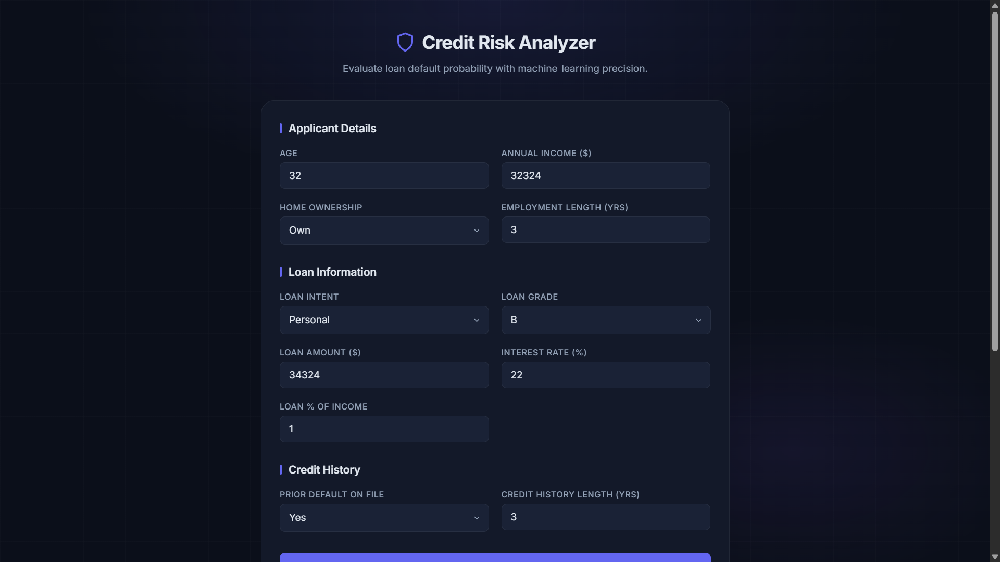

# Credit Risk Analyzer

An end-to-end machine learning application that estimates a loan applicant's **probability of default** using applicant, loan, and credit-history information.

🚀 **[Try the Live Demo](https://credit-risk-assesment-using-shap-karu.onrender.com/)**

The app displays an estimated default probability and compares it with a selected decision threshold to show a risk category.

## Screenshots

**Applicant details and loan inputs**

**Risk analysis result**

## How it works

1. Preprocess applicant and loan data, including numerical and categorical features.
2. Compare Logistic Regression with XGBoost and tune the XGBoost model.
3. Calibrate predicted probabilities and select a decision threshold.
4. Serve predictions through a **FastAPI** backend to the web interface.
5. Use **SHAP** in the notebook to understand feature contributions.

## Tech stack

Python · Pandas · NumPy · Scikit-learn · XGBoost · SHAP · FastAPI · Joblib

## Real-world use

The score can help a lender or credit analyst prioritize applications for further review. It is a decision-support tool, not a final lending decision. Real-world use would require independent validation, fairness testing, ongoing monitoring, and regulatory review.

> **Note:** The displayed probability is a model estimate, not a guarantee of whether an applicant will repay a loan.
