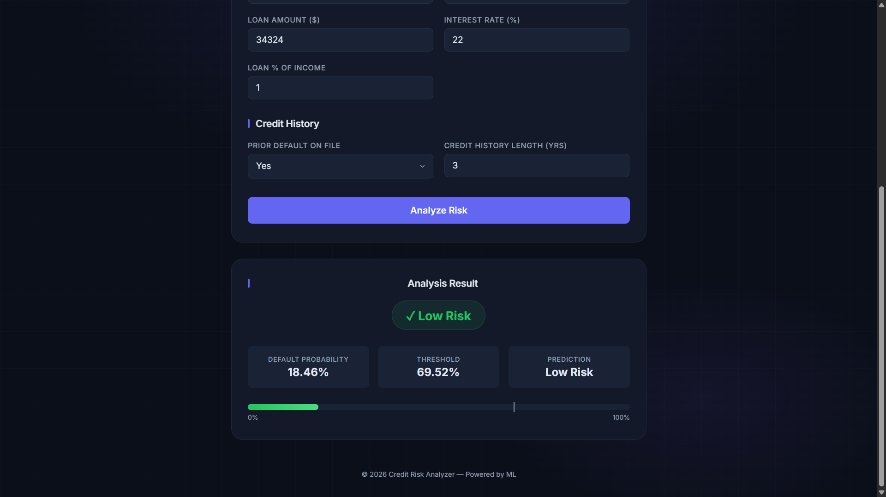

# Credit Risk Analyzer

An end-to-end machine learning application that estimates a loan applicant's **default probability** from personal, loan, and credit-history details. The web interface displays the estimated probability, decision threshold, and risk category.

## Screenshots

**Applicant and loan details**

**Risk prediction result**

## How it works

1. **Prepare the data** — validate records, handle duplicates and outliers, and split the data for training and evaluation.
2. **Train the model** — preprocess numerical and categorical features, handle class imbalance, compare Logistic Regression with XGBoost, and tune XGBoost hyperparameters.
3. **Calibrate and classify** — apply sigmoid probability calibration and select a decision threshold using precision-recall/F1 analysis.
4. **Serve predictions** — save the trained model and threshold, then expose predictions through a FastAPI backend to the web application.

The notebook also uses **SHAP** to inspect global feature importance and explain individual predictions.

## Tech stack

Python · Pandas · NumPy · Scikit-learn · XGBoost · SHAP · FastAPI · Joblib

## Potential real-world use

A lender or credit analyst could use the score as an initial screening signal to prioritize applications for further review. It should support—not replace—human assessment. Before use in real lending decisions, the system needs independent validation, fairness and bias testing, monitoring, and applicable legal and regulatory review.
